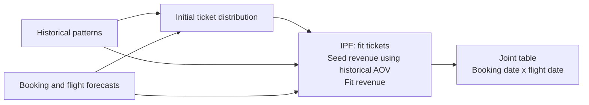

"# booking_to_flight_corr" 
## Usage:
- requirements: `pip install -r requirements.txt`
- run `python src/eda.py` to add lead time and AOV to the actuals dataset

## Historical EDA plots

Run `python src/plots.py` from the project root to update the month columns in
the clean actuals CSV and save plots for all clusters in `plots/`. Use
`python src/plots.py --clusters "City" "Greece" --size-variable Revenue` to
select clusters and size bubbles by revenue; the default size is `Tix`.
Use `python src/plots.py --forecast_lead_times` to plot only revenue by lead
time from the unfiltered joint forecast. Add `--clusters "City" "Greece"`
to select forecast clusters; otherwise all forecast clusters are plotted.

Use `python src/plots.py --forecast-booking-flight-months --clusters "City"`
to plot booking versus flight months for 2026 bookings in the unfiltered joint
forecast. Add `--size-variable Revenue` to size bubbles by revenue instead of
tickets. Flights after 2026 appear in the `Later year` row. Forecast filenames
end in `_forecast`, so they do not overwrite historical plots. Omit `--clusters`
to plot all forecast clusters.

Month plots combine booking years. Same-year flights are grouped by their flight
month; all flights in a later year are combined in the separate `Later year` row
for each booking month. This row does not distinguish individual later years or
flight months.
Lead-time bars show total revenue, with 180 days in the 91–180 bucket and 181+
in the last bucket. The heatmap uses the unweighted median per input row across
all years; grey cells indicate missing combinations.

## Booking-to-flight allocation matrices

Run `python src/bf_allocation_matrix.py` to process all clusters in the clean
actuals. Use `--clusters "City" "Greece"` to select clusters and
`--metric Revenue` to save revenue instead of the default `Tix` matrix.
Each semicolon-delimited CSV in `data/matrices/` has sorted booking dates as
rows, sorted observed flight dates as columns, and zeros for unobserved pairs.
Duplicate date pairs are summed. The required filename does not include the
metric, so rerunning for another metric overwrites the previous matrix.

The CSV is a conventional dense matrix, but it is streamed one row at a time;
the intermediate observed pairs remain sparse. The heatmap in `plots/` always
shows summed `Tix`. Its axes cover calendar dates, including dates without
observations. To bound memory and make large date ranges legible, each axis is
limited to 512 equal-width calendar-day bins; the title states the bin widths.
The CSV retains the original daily resolution regardless of the heatmap bins.

## Main IPF model

The model fits each market cluster separately. Rows represent booking dates;
columns represent flight dates. IPF alternately scales the 2026 booking rows
and flight columns to their forecast totals, stopping at the error tolerance or
the iteration limit.

Carry-in booking rows and carry-out flight columns are free margins: they are
not scaled to 2026 forecast totals. The lead-time grid excludes cells outside
both forecast years. Reaching the iteration limit does not guarantee that the
forecast margins match.

Run `python src/ipf_joint_table.py` to process all clusters, or use
`--clusters "City" "Greece"` to select clusters. The script saves two
semicolon-delimited CSVs in `data/output/`, with tickets and revenue formatted
to six decimal places. Their names include the cluster name for a single
cluster, or the initials of each cluster for multiple clusters. For example,
the City and Greece outputs are `joint_forecast_2026_C_G.csv` and
`joint_forecast_2026_C_G_filtered.csv`. Use `--output` to set a different base
path; the cluster label and `_filtered` suffix are still appended.
Different cluster selections can have the same initials; use different base
paths if those outputs need to be kept separately.

The full output includes carry-in and carry-out dates. The filtered output
retains only rows whose booking and flight dates both appear in their respective
forecasts for that cluster, so its margins need not match the forecasts. Rounding
the exported values can also introduce small differences in aggregate totals.

A booking-date comparison is saved in `data/output/comparison/`, using the
saved filtered table and the clean, sorted booking forecast for the fitted clusters.
It sums across clusters, includes dates present on either side, and reports
filtered total minus forecast for both tickets and revenue. With a custom
`--output`, the comparison directory is alongside that output instead.
Use `--post-process-only data/output/joint_forecast_2026_Canaries_filtered.csv`
to compare an existing filtered table without fitting. Clusters are inferred
from the table unless `--clusters` is specified; specify clusters explicitly if
the table is empty or a fitted cluster has no filtered rows. This mode does not
recreate the fitting summary.

Run `python src/post_processing.py --booking-revenue-difference-only` to plot
daily 2026 booking forecast revenue minus 2025 actual revenue for the same
calendar date, summed across clusters. Missing dates are shown as gaps. This
option does not run the other post-processing plots.

## Booking-to-flight correlations

Run `python src/correlations.py --ipf-output data/output/joint_forecast_2026_Canaries_filtered.csv --clusters Canaries`
to compare one or more clusters. Omit `--clusters` to compare all clusters in
the selected filtered output. `--metric Revenue` plots revenue instead of the
default Tix; `--actuals` and `--plot-dir` override the default paths. The script
prints the weighted Pearson correlation of booking and flight month numbers for
both metrics, their forecast values, and forecast-minus-actual differences.

For each heatmap cell, the value is the weighted Pearson correlation between the
two binary indicators “booking month is b” and “flight month is f”. Weights are
the Tix or Revenue totals in the joint table. The plots use a common −1 to 1
scale; grey means an indicator is constant and its correlation is undefined.
Only same-calendar-year booking/flight pairs are included on both sides, with
historical years pooled. The forecast's filtered scope excludes carry-in and
carry-out, so the comparison does not describe the full forecast. The printed
scalar treats months as linear numbers, so December and January are far apart;
it should not be interpreted as a circular seasonal correlation.

For programmatic use, `analyze_cluster(actuals, forecast, cluster)` accepts
DataFrames and returns a scalar summary and the Tix and Revenue indicator
matrices. `plot_correlations` saves the selected side-by-side heatmap.
